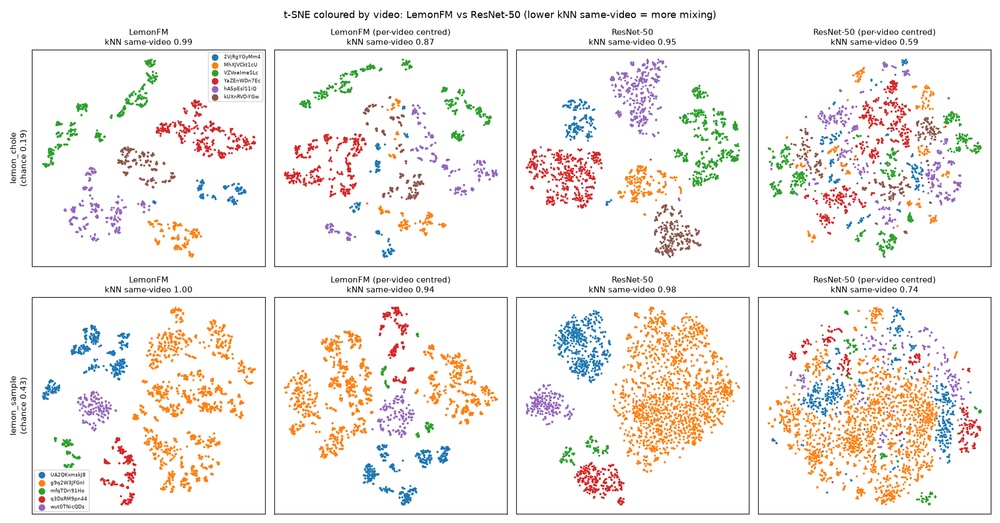

# Phase 0: can image embeddings choose which frames to label?

**Question.** LEMON has ~86M unlabelled frames from 4,194 surgical videos. Before labelling, can we use
image embeddings and clustering (TypiClust-style: one typical frame per k-means cluster) to pick a
representative, diverse set of frames? Or is simple sampling just as good?

**Answer.** Not across videos. Embeddings cluster by **which video** a frame comes from, not by what is
in it (tools, surgical step). So the project uses **stratified sampling in time** within each video.

## Data
LEMON videos are flat `.mp4` files (h264, 25–30 fps, 898×668 to 1280×720), collected from YouTube and
already cleaned of out-of-body footage. Procedure type and robotic/laparoscopic flag per video come from
[`labels.json`](https://github.com/visurg-ai/LEMON/blob/main/labels.json). Two small test sets, sampled at 1 fps:

| Set | Videos | Frames | Chosen by |
|---|---|---|---|
| mixed | 5 (hernia repair, adrenalectomy (dog), appendectomy, robotic nephrectomy, robotic cystectomy) | 3,669 | one random video per file-size quintile, seed 0 |
| cholecystectomy | 6 laparoscopic cholecystectomies | 2,604 | random from lap-only cholecystectomy videos of 50–250 MB, seed 0 |

## Method
- **Encoders:** [LemonFM](https://huggingface.co/visurg/LemonFM) (ConvNeXt-Large pretrained on LEMON, 1536-d)
  and ImageNet ResNet-50 (2048-d). Frames resized to 224×224, ImageNet normalisation.
- **Variants:** full dimensions vs PCA to 512/256/128/64; raw vs **per-video centred**
  (subtract each video's mean embedding, so only within-video differences remain).
- **Check A, mixing across videos:** k-means (k=20) cluster purity, and the **kNN same-video rate**:
  the share of each frame's 10 nearest neighbours from its own video, ignoring same-video frames within
  ±30 s (near-duplicates). Chance = the rate if neighbours were random.
- **Check B, cluster content:** montages of random frames from each cluster, inspected by eye.

## Results
kNN same-video rate (lower = more mixing across videos):

| | Chole raw | Chole centred | Mixed raw | Mixed centred |
|---|---|---|---|---|
| chance | 0.19 | 0.19 | 0.43 | 0.43 |
| LemonFM | 0.99 | 0.87 | 1.00 | 0.94 |
| ResNet-50 | 0.95 | 0.59 | 0.98 | 0.74 |



- **Every variant clusters by video**, even among videos of the same procedure. PCA to any size changes
  nothing: video identity is the highest-variance signal, so PCA keeps it.
- **Per-video centring helps, but not enough.** ResNet-50 mixes most, but its mixed clusters are vague
  "dark scene, one instrument" groups: it mixes because it sees less detail, not because it groups by tool.
- **LemonFM's clusters are meaningful within a video** (e.g. one cluster per tool or scene), but rarely across videos.
  Only a few events form true cross-video clusters (specimen bag retrieval, views with no tools).
- **Why:** web videos differ in camera, lighting/colour, tool brand, picture borders (circular, octagonal,
  full frame) and burned-in overlays. Tools cover a small part of each frame, so a whole-image embedding is
  dominated by each video's look.

## Decision
- **Default: stratified sampling in time** within each video: window = video length ÷ frames wanted,
  one random frame per window, with a cap per video. Even coverage, no near-duplicates, no embeddings needed.
- **Manual test set:** held-out videos, sampled the same neutral way (never chosen by clustering).
- **Possible extension:** clustering *within* each video vs stratified sampling at equal budget (IoU vs budget).


## Reproduce
Run from the repo root. Needs `ffmpeg` and the pinned packages (`python -m pip install -r requirements.txt`).
Videos go in `data/raw/<set>/` (from the gated HF dataset `visurg/LEMON`) and LemonFM weights in
`models/lemonfm/lemonfm.pth`. 

```bash
E=experiments/phase0_frame_sampling
python $E/inspect_videos.py data/raw/lemon_chole data/processed/lemon_chole                  # ffprobe stats + contact sheets
python $E/embed_frames.py data/raw/lemon_chole data/processed/lemon_chole/emb_lemonfm        # LemonFM, 1 fps
python $E/embed_frames.py data/raw/lemon_chole data/processed/lemon_chole/emb_resnet50 --model resnet50 --half
python $E/explore_embeddings.py data/processed/lemon_chole/emb_lemonfm --center              # PCA dims table + t-SNE grid
python $E/compare_tsne.py data/processed/lemon_chole data/processed/lemon_sample             # figure above
python $E/cluster_montage.py data/raw/lemon_chole data/processed/lemon_chole/emb_resnet50 --center
```
